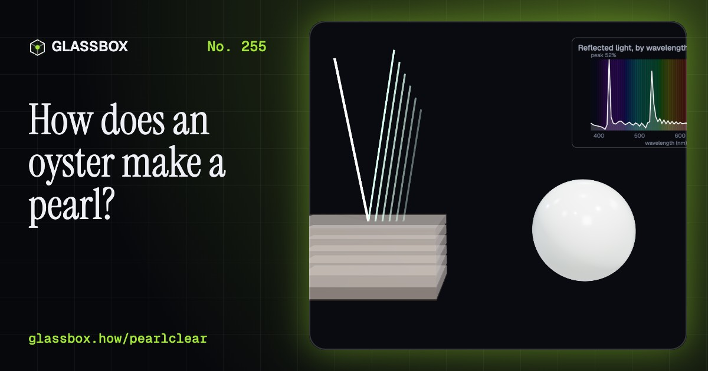
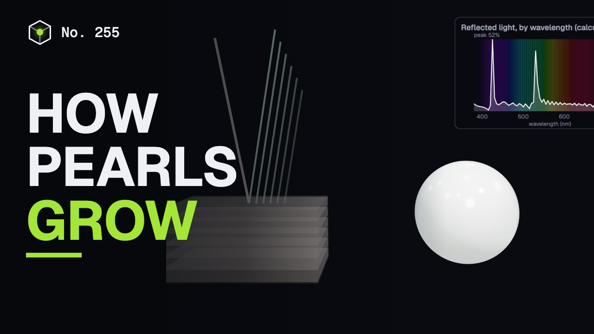
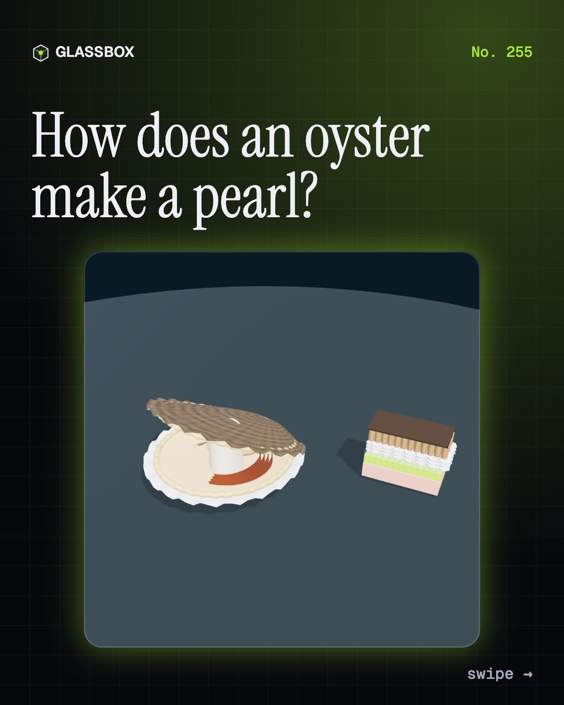
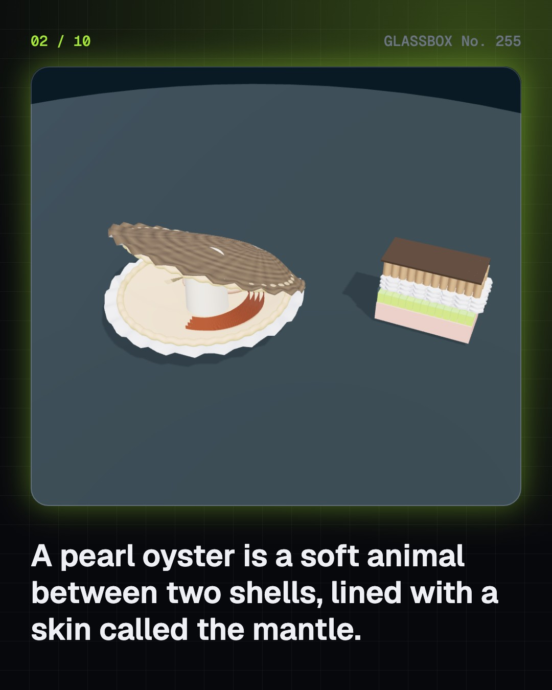
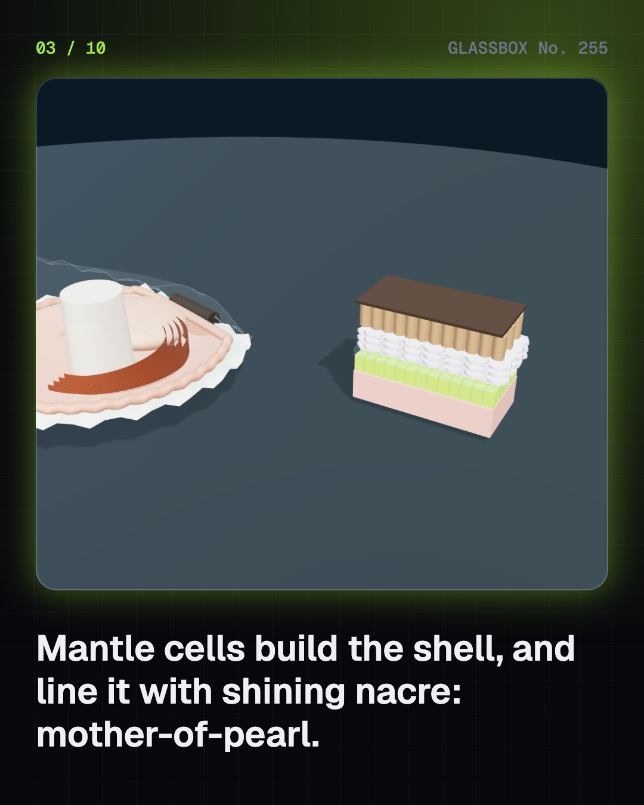
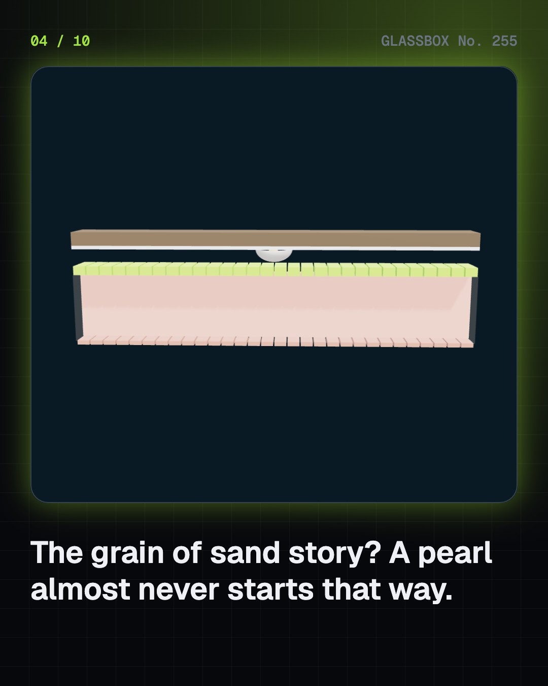

<!-- glassbox:start -->
<!-- Generated from glassbox.json by the Glassbox hub (npm run readme -- pearlclear). Edit glassbox.json, not this block. -->
<p align="center"><a href="https://glassbox.how/e/pearlclear/"></a></p>

<h1 align="center">PearlClear</h1>

<p align="center"><b>How does an oyster make a pearl?</b><br>Forget the grain of sand. A pearl starts when a few shell-making cells end up in the wrong place, then grows thousands of layers each thinner than a bacterium. Open an oyster, grow a pearl, and see why it shines.</p>

<p align="center"><a href="https://glassbox.how/pearlclear/"><b>▶ Play with it</b></a> &nbsp;·&nbsp; <a href="https://glassbox.how/e/pearlclear/">Read the 60-second explainer</a></p>

<p align="center">
  <a href="https://glassbox.how/e/pearlclear/"></a>
  <a href="https://glassbox.how/e/pearlclear/"></a>
  <a href="LICENSE"></a>
  <a href="LICENSE-CONTENT.md"></a>
  <a href="#privacy"></a>
</p>

## In 60 seconds

1. **A shell-making skin.** A pearl oyster is a soft animal between two hinged shells. Lining them is the mantle, a sheet of tissue whose outer cells build the shell: an organic skin, a layer of prisms, then on the inside layer after layer of nacre, or mother-of-pearl. A pearl is made of the same nacre by the same kind of cell.
2. **Not a grain of sand.** Sand rarely starts a pearl. Grit between the mantle and the shell is usually flushed out, or coated onto the shell as a blister. A loose pearl needs mantle cells inside the soft tissue. A burrowing parasite or an injury can drag a few in. They multiply into a pocket, the pearl sac, and coat whatever is inside with nacre.
3. **Bricks and mortar.** Nacre is a wall of flat aragonite tablets, about half a micrometre thick and 5 to 8 micrometres wide, glued by organic mortar 10 to 30 nanometres thick. One pearl imaged in full detail held 2,615 layers laid over 548 days, four or five a day. Growth rates vary with species and water.
4. **Why it is tough.** Plain aragonite is brittle as chalk. In nacre a crack has to zigzag through the mortar around each tablet, and the tablets slide and grip as it goes. Nacre can absorb up to about a thousand times more energy before breaking than the pure mineral, so engineers copy its design.
5. **Colour from layers.** Each boundary between tablet and mortar reflects a little light. Where the extra trip between layers is a whole number of wavelengths, the reflections add up. That is thin-film interference repeated hundreds of times. Tilt a pearl and the colour shifts. Pigment gives the body colour, and interference gives the overtone.
6. **A bead and a scrap of skin.** Kokichi and Ume Mikimoto grew half-pearls in 1893. Tatsuhei Mise patented round cultured pearls in 1907, and Tokichi Nishikawa filed for the same method. A technician slips a shell bead and a square of donor mantle into a living oyster. The cells grow round the bead and coat it in nacre over months or years.

## Words worth knowing

| Term | Meaning |
|---|---|
| **Mantle** | The sheet of tissue that lines a mollusc's shell. Its outer epithelial cells secrete the shell and pearls. |
| **Nacre** | Mother-of-pearl: the iridescent inner layer of many shells and the material of pearls, made of aragonite tablets and organic mortar. |
| **Aragonite** | A crystal form of calcium carbonate. Nacre tablets are made of it. |
| **Pearl sac** | A closed pocket of mantle epithelial cells inside the tissue that lays nacre inward. Every pearl grows in one. |
| **Blister pearl** | Nacre grown onto the inside of the shell over an intruder. It is part of the shell, not a loose pearl. |
| **Organic matrix** | The thin film of proteins and chitin, 10 to 30 nanometres thick, that glues nacre's tablets together. |
| **Thin-film interference** | Reflections from the top and bottom of thin layers that add up for some colours and cancel for others. |
| **Lustre and overtone** | Lustre is how bright and sharp a pearl's reflections are. Overtone is a colour that seems to float over its body colour. |
| **Cultured pearl** | A real nacre pearl grown with human help, usually from a shell bead and a square of donor mantle. |
| **Mise-Nishikawa method** | Placing a bead and a mantle graft in an oyster's gonad: the basis of round pearl culture since the 1900s. |

## A short history

**From an 8,000-year-old pearl in Abu Dhabi to billions of farmed pearls a year, and the divers who paid for them.**

- **5700 BCE** · The oldest known natural pearl (Neolithic people of Marawah; DCT Abu Dhabi archaeologists, Marawah Island, Abu Dhabi)
- **77** · Pliny: pearls grow from dew (Pliny the Elder, Rome)
- **1528** · Forced divers at Cubagua (Enslaved Indigenous divers; a few enslaved Africans, Cubagua island and Nueva Cádiz)
- **1893** · The first cultured half-pearls (Kokichi Mikimoto and Ume Mikimoto, Ago Bay and Ojima (now Mikimoto Pearl Island), Toba)
- **1895** · Ama divers tend the first pearl farms (Ama women divers of Ise-Shima, Ago Bay and Toba)
- **1907** · The secret of the round pearl (Tatsuhei Mise and Tokichi Nishikawa, Japan)
- **1935** · The Gulf pearl trade collapses (Gulf pearling communities, Bahrain, Qatar and the Trucial coast)
- **1972** · Black pearls from Tahiti (Jacques and Hubert Rosenthal, Jean-Claude Brouillet, Robert Wan, Salvador Assael, Robert Crowningshield, Bora Bora, Manihi and other atolls)

The full story, with 39 moments, charts, people and 41 sources: [glassbox.how/e/pearlclear/history](https://glassbox.how/e/pearlclear/history/). The data lives in [`history.json`](history.json).

## Video and slides

Made with the Glassbox studio from this box's storyboard (`window.glassbox.director`). Free to reuse under CC BY 4.0.

<a href="https://glassbox.how/pearlclear/glassbox/video.mp4"></a>

<p><a href="glassbox/slide-1.jpg"></a> <a href="glassbox/slide-2.jpg"></a> <a href="glassbox/slide-3.jpg"></a> <a href="glassbox/slide-4.jpg"></a></p>

| File | What | Size |
|---|---|---|
| `glassbox/slide-1…10.jpg` | Instagram carousel | 1080×1350 |
| `glassbox/thumb.jpg` | YouTube thumbnail | 1280×720 |
| `glassbox/cover.jpg` | Share card and repo social preview | 1200×630 |

## Privacy

This box has no accounts and no ads, and it ships its own fonts and libraries. When you run it yourself it sends nothing anywhere. On glassbox.how, the site's `/bar.js` also loads Glassbox's analytics: **Google Analytics** to count visits (it asks first in the EU, UK and Switzerland, and stays off when your browser sends Global Privacy Control or Do Not Track) and **ClickTrust** to detect bots.

It remembers a few things **in your own browser only**, and never sends them anywhere:

| Browser storage key | What it holds |
|---|---|
| `pearlclear.v1` | Which chapters you have opened, your best quiz scores, and sound on or off. |

Exactly what each one sees is at [glassbox.how/privacy](https://glassbox.how/privacy/).

## Licences

- **Code:** [MIT](LICENSE). Use it, change it, ship it.
- **Explanations, text, images and videos** (`glassbox.json`, `glassbox/`): [CC BY 4.0](LICENSE-CONTENT.md). Credit “Glassbox, glassbox.how/e/pearlclear”.
- **Third-party parts** keep their own licences: [three.js](https://threejs.org) (MIT), [Geist, Instrument Serif](https://openfontlicense.org) (SIL OFL 1.1), [CIE colour-matching fit (Wyman, Sloan and Shirley 2013, JCGT), a published formula reimplemented in our own code](https://jcgt.org/published/0002/02/01/) (Formula cited, no code copied).
- The Glassbox name and logo aren't covered by either licence. See the [terms](https://glassbox.how/terms/).

Found a mistake? [Open an issue](https://github.com/bdeeps/pearlclear/issues). Corrections happen in public.
<!-- glassbox:end -->

## Run it

It's plain HTML, CSS and JavaScript. No build step and no dependencies. Run locally, it contacts no other website.

```bash
python3 -m http.server 8000
```

Three.js and the fonts ship in `vendor/` and `fonts/`, so it also works offline.

Then open http://localhost:8000.

## How it's built

| File | What |
|---|---|
| `index.html`, `css/app.css` | The page and its styles |
| `js/app.js`, `js/stage.js`, `js/ui.js`, `js/kit.js` | The shared Glassbox 3D engine: chapters, 3D stage, controls, quiz, video director |
| `js/chapters/*.js` | One file per chapter: the 3D model, controls, text, key terms, quiz and video scenes |
| `glassbox.json` | Title, question, explainer beats, key terms, browser storage and credits shown on glassbox.how |
| `reel` in each chapter | The storyboard the Glassbox studio records into short videos |
| `glassbox/` | The published video, slides, thumbnail and post copy |
| `fonts/`, `vendor/three/` | Self-hosted Geist and Instrument Serif (SIL OFL 1.1) and three.js (MIT) |
